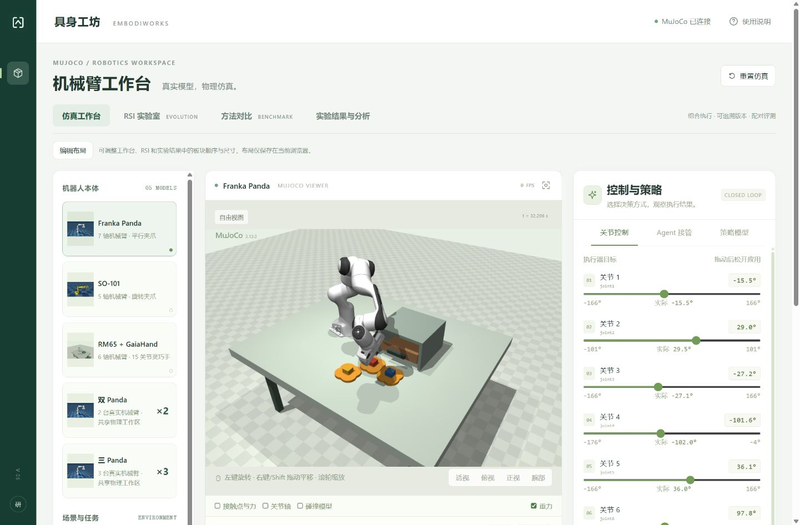
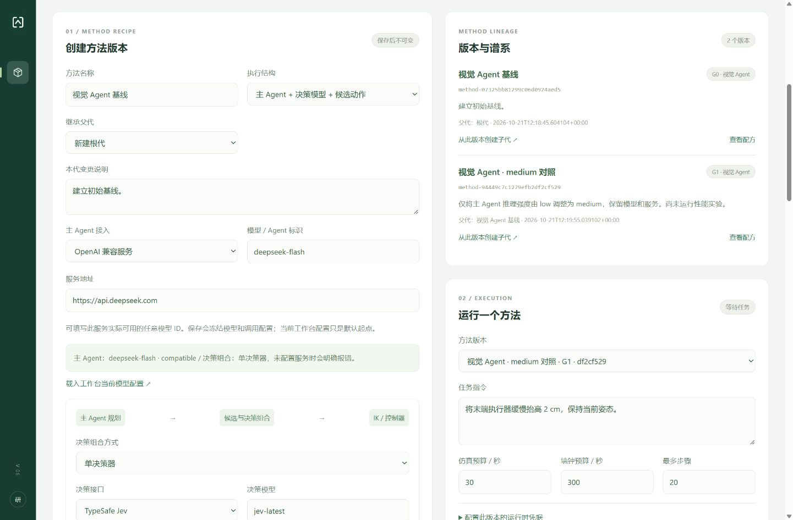
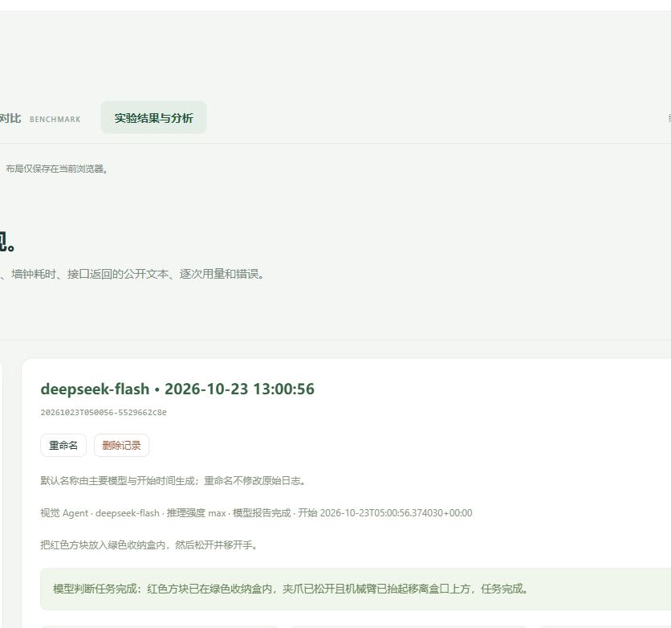

<p align="center">
  <picture>
    <source media="(prefers-color-scheme: dark)" srcset="public/brand/embodiworks-logo-dark.svg">
    
  </picture>
</p>
<p align="center"><strong>具身工坊 · 从观察到动作，从策略到实验。</strong></p>
<p align="center">An open MuJoCo workbench for embodied agents, policies, and reproducible experiments.</p>
<p align="center">
  <a href="docs/INSTALL.md">安装运行</a> ·
  <a href="docs/USAGE.md">使用指南</a> ·
  <a href="RSI_WORKBENCH.md">组合策略与评测</a> ·
  <a href="CONTRIBUTING.md">参与贡献</a>
</p>



**在同一个物理世界里，连接模型、执行动作、比较策略。**
EmbodiWorks 将 MuJoCo 原生仿真、多路视觉观察和实验记录放进浏览器，面向具身智能研究与原型验证。模型负责提出动作，本地 IK 与执行器负责运动。

## 可以做什么

| 能力 | 工作方式 |
| --- | --- |
| 真实物理仿真 | Panda、SO-101、RM65 + GaiaHand，以及双／三 Panda 共享场景；七类操作场景。 |
| 灵活接入策略 | Codex 本机登录、OpenAI、DeepSeek／兼容 API、Claude、自定义 Agent，以及 SmolVLA 与自定义 VLA/WAM。 |
| 组合决策 | 主 Agent、决策器和动作策略分别配置；支持单决策、级联复核与加权投票。 |
| 对照实验 | 冻结方法版本与协议，在同一初态、配对种子下比较，保留验证晋升与回滚记录。 |
| 结果可追溯 | 可选轨迹视频、逐轮公开输出、服务返回的推理摘要、tokens、耗时、错误和费用估算。 |

## 快速开始

需要 **Python 3.13、Node.js 22.12+、Git 和可用的 OpenGL 环境**。首次使用请按[安装指南](docs/INSTALL.md)创建 Python 环境、安装依赖并下载机器人资源。

```sh
git clone https://github.com/shank000/embodied-agent-studio.git
cd embodied-agent-studio
# 完成安装指南中的 Python 环境与机器人资源准备后：
npm ci
npm run build
npm start
```

浏览器打开 **http://127.0.0.1:8000**。在启动终端按 **Ctrl+C** 关闭服务。开发前端另运行 `npm run dev`。

| 系统 | 当前验证范围 |
| --- | --- |
| Windows | 已验证工作台、真实模型、原生渲染与实验流程。 |
| Linux | 已验证 Ubuntu 无头 OSMesa 渲染与服务控制；WSL2 + WSLg 验证了真实模型和三路相机。 |
| macOS | 安装、构建、启动器与真实模型运动通过 CI；CGL 图形界面仍待 Mac 真机验收，策略暂用 CPU。 |

三种系统共用源码与 `npm start`。CI 检查三平台的安装、构建与模型运动，另在 Linux 验证原生离屏渲染；完整验证范围见[安装说明](docs/INSTALL.md)。

## 看见实验过程


*组合主 Agent、决策器与策略，保存方法版本，在冻结协议下比较。*


*从一条记录回看视频、逐轮输出、调用耗时和用量。*

## 文档与参与

- [安装与平台说明](docs/INSTALL.md) · [完整使用指南](docs/USAGE.md)
- [组合方法、评测与自定义 Agent](RSI_WORKBENCH.md) · [VLA / WAM 策略协议](POLICY_PROTOCOL.md)
- [机器人模型来源](MODEL_SOURCES.md) · [贡献指南](CONTRIBUTING.md)

欢迎提交新模型适配、场景、策略接口与可复现的问题报告。当前平台用于仿真研究；RSI 模块提供版本与评测机制，尚未自动生成子代或训练权重。GaiaHand 使用公开的 **15 关节版本**，并非 Gaia Hand 20。

源码采用 [MIT License](LICENSE)。机器人资产与模型权重遵循各自上游许可；凭据、个人实验记录和权重不随源码发布。
