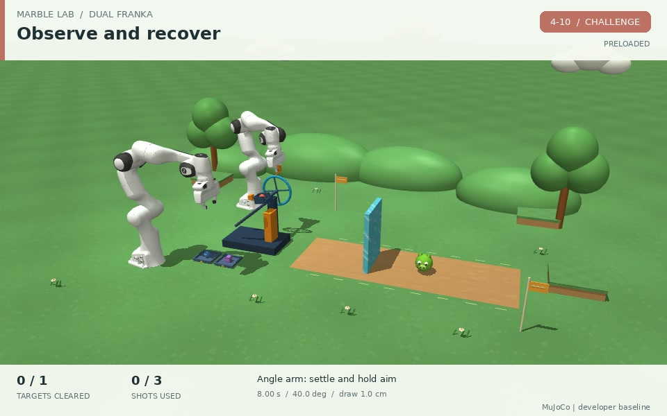
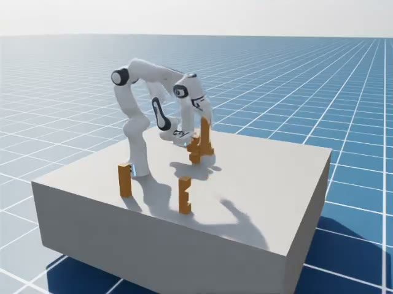
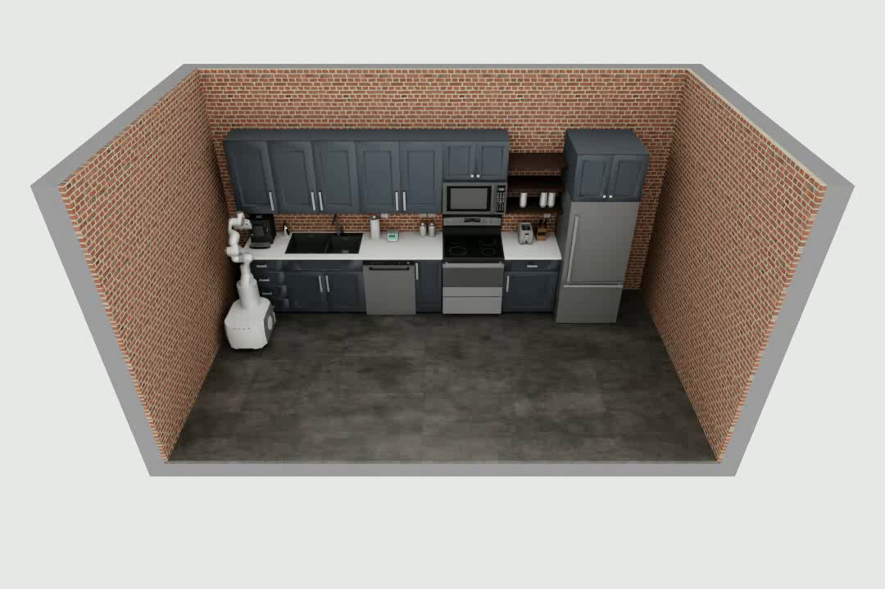
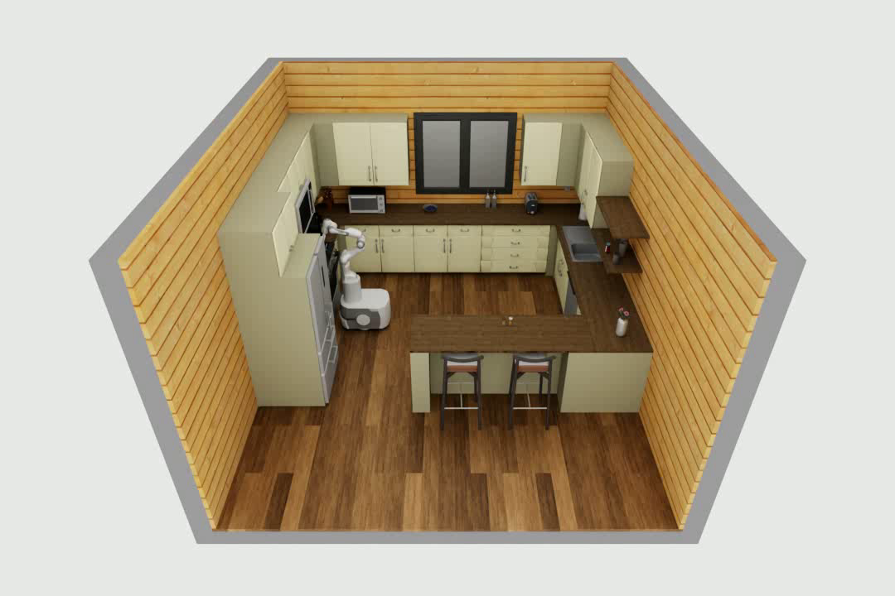
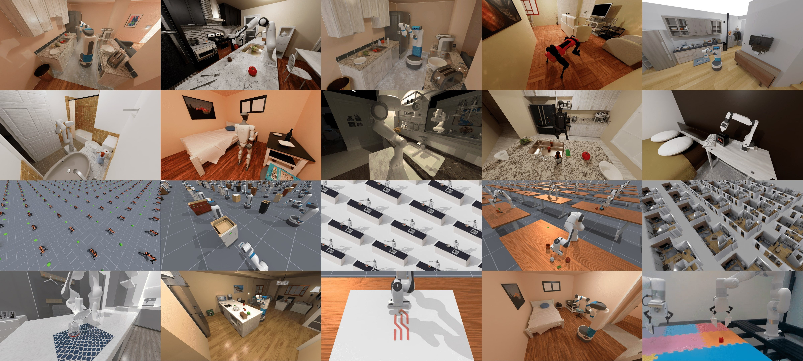

# 具身工坊：机器人原生智能路由研究环境

研究规划与首批实施证据 · 2026-10-30 · v1.2 图文版

> **研究对象是完整执行系统：智能路由 API + 机器人 harness + 工具 + 物理环境 + 独立评价。** 研究目标是在任务成功率和安全约束下，降低实际成本与完成时间，并积累可用于强化学习的决策轨迹。第01–19节保留调研与改造前规划，第20节记录首批已实施能力和实际验收范围；其他规划项仍须按阶段完成。

## 01 · 结论与研究问题

建议把具身工坊升级为“有明确任务规则、持续物理反馈、可审计成本、可训练决策策略”的研究环境。先在现有 MuJoCo 和 RoboCasa 路径建立完整闭环，再通过任务适配器接入 Embodied Playground；不同引擎继续保留各自的动作、时间和评价语义。

核心实验问题：**在同一任务分布、观察权限和预算下，系统何时应继续本地执行，何时应调用大模型、视觉工具、VLA 或决策服务，以及失败后如何恢复？** 最终比较成功率、累计真实成本、端到端时间三个量的 Pareto 前沿，并报告违规率。

“只有 GPT-6 能控制机器人”不宜写进架构或研究结论。用户提供的参考项目已经报告两种模型的试验，能力还依赖任务、harness 和权限设置。可以先采用当前最可靠模型作为强基线，同时比较同一模型的不同推理配置、工具选择、观察频率、计划复用和恢复方式；这些已经提供可研究的路由空间。[S1]

三个预注册假设：

1. **H1：任务分阶段的路由**比每轮固定调用强模型，在成功率不劣于预设门槛时减少成本。
2. **H2：持续反馈与有界恢复**在受扰动任务中提高最终成功率，且恢复产生的收益超过额外耗时和费用。
3. **H3：学习式路由**在未见任务结构或布局上优于预算相同的固定规则；只在随机种子变化上改善，不足以支持结构泛化。

这些是假设，尚无本项目数据证明。将“程序演化”“路由强化学习”“VLA 权重微调”分别登记为不同实验类型，避免混为一种训练。

## 02 · 证据范围与现状

**改造前基线。** 本节保留初次调研时的服务状态和能力审计，后续实施及验收以第20节为准。下文的8000连接失败是初次访问结果，不代表后续服务状态。

本次审计基于工作区 HEAD `4b7a5ee` 及当前未提交修改。查阅官方网页、代码文档和本地实现；未启动模型训练或大规模仿真。2026-10-30 访问本机 8000 的状态接口连接被拒绝，因此本次不宣称服务运行验收通过。本地 `papers/`、`literature/` 没有可用论文库，arXiv helper 未解析到，采用官方项目、arXiv 页面及规范文档检索；没有覆盖个人文献管理器。

| 证据层级 | 当前可以确认的内容 | 结论边界 |
|---|---|---|
| 本次代码审计 | 多后端适配、原生任务判据、API 接入、用量/费用、训练转移导出均有实现 | 代码存在不等于所有配置端到端可用 |
| 历史原生验证 | 10月27日 HarnessPAI：红块入盒开发3/3、留出2/2；分拣场景抬红块开发2/2、留出2/2 | MuJoCo/Panda、特定种子；不是原论文成绩或通用任务成功率 |
| 历史后端验证 | 本地文档记录多个后端的原生样本测试 | RoboCasa 10月26日统一脚本因测试模块导入失败未完成复核；较早原生样本通过不能替代当前复核 |
| 官方来源声明 | Embodied Playground、RoboCasa 等任务和协议资料 | 上游数量不是本地已适配或已求解数量 |
| 本报告建议 | 任务图、路由轨迹、奖励与成本扩展、阶段验收 | 全部是待开发/待验证的工作项 |

已有代码最值得保留的部分：`server/simulators.py` 和 `server/backends/` 的隔离运行机制；`server/agent.py`、`policy.py` 和 HarnessPAI 接口；`runlog.py`、`telemetry.py`、`analysis.py`、`training_data.py`；`research.py` 的冻结协议、配对评测和版本管理。不要再建立第二套相同功能的实验档案系统。

## 03 · 六项要求逐一对应

| 用户要求 | 已有基础 | 关键缺口 | 对应交付物 | 验收信号 |
|---|---|---|---|---|
| R1 丰富、实用、灵活的任务空间 | MuJoCo 7类场景；RoboCasa、LIBERO、ManiSkill、家庭环境等目录 | 原生任务较短；任务参数、前置关系、扰动和组合定义不统一；目录与可运行范围易混淆 | 版本化 TaskSpec、任务能力清单、12项首批复合任务 | 每个任务都有有效初态、可完成证据、失败反例、固定划分和依赖说明 |
| R2 端到端物理复合任务与细粒度评价 | 观察→决策→动作→反馈；原生终局验收和保持条件 | 缺通用阶段事件与时序规则；推理时物理暂停；不同 suite 的 finish 语义不同 | 任务状态机、奖励向量、阶段轨迹、静态/动态两种时钟协议 | 不能假完成、跳步骤、刷阶段奖励；失败恢复后状态一致；动态任务真实计入延迟 |
| R3 harness 与可配置路由 API | Codex、Responses、Chat、Anthropic、自定义服务；可配置URL/密钥/模型 | 请求模型/返回模型不足以解释网关内部路由；HarnessPAI绑定MuJoCo/Panda | 路由元数据契约、网关适配器、环境会话接口 | 一次请求可追踪到实际模型、选择原因、费用与动作；缺字段明确未知 |
| R4 接入视觉/VLA/决策等工具 | policy/decision协议；HarnessPAI具名工具；组合方法 | 缺统一能力发现、版本/坐标/新鲜度契约；并非任意工具可直接用于任意机器人 | 轻量工具注册表、能力检查、工具调用轨迹 | 不兼容工具启动前拒绝；过期视觉结果不能驱动动作；每次调用可追溯 |
| R5 全过程成功、费用、时间、失败恢复 | RunLog、逐轮计时、用量、视频、价格快照、非模型费用登记 | 自动资源计量和跨服务父子调用关联不足；进化开发成本与执行成本需分开 | 分项成本账本、调用树、恢复链、成本覆盖率 | 子调用不重复收费，缺失不填0，费用对账误差在约定范围内 |
| R6 成本来源与原因 | 已有按模型/阶段的成本归因 | 描述性分组尚不能证明某项工具或恢复值得调用 | 任务×阶段×模型×工具×重试分析，配对消融 | 能定位最大成本来源，并用对照试验验证改动的成本/成功率影响 |

实现顺序：R2、R3、R5 的最小闭环与 R1 的首批任务共同推进；R4 在真实工具接入时补齐；R6 基于可信账本运行。不要等所有场景齐全后才补评价和成本。

## 04 · 参考平台：吸收什么，保留什么边界

用户给出的链接目前对应 **Embodied Playground: A Long-Horizon Agentic Robotics Benchmark for Physical, Strategic, and Spatial Reasoning**。官方展示410个任务环境、EP-100精选集、五个套件：Launch、Tower、Lock、Cube、Home；这比单纯重复抓放更适合研究物理因果、规则约束和长期计划。EP-100每任务四种条件，EP-20用于紧凑诊断，不是完整集的无偏替代。[S1]

<div class="figure-grid">
<figure id="figure-ep-launch">

<figcaption><span class="figure-label">图1 · 物理因果与恢复</span><strong>观察结果 → 调整 → 再次执行。</strong>官方双Panda发射任务的参考演示封面，适合说明有限资源、间接作用和恢复决策。本平台拟先接入其MuJoCo子集；此图不代表本地已完成适配。来源：<a href="https://winniechen2002.github.io/Agent-bench-website/">Chen Feng / AgentBench</a>，<a href="https://winniechen2002.github.io/Agent-bench-website/data/media.json">官方媒体说明</a>将其标为使用特权信息的开发者参考轨迹，非计分模型结果。<small>原图未修改；图版引用日期2026-10-30。</small></figcaption>
</figure>
<figure id="figure-ep-lock">

<figcaption><span class="figure-label">图2 · 空间关系与工序依赖</span><strong>部件识别 → 对齐 → 按依赖装配。</strong>官方六件孔明锁装配参考演示封面，启发T10结构拆装与T11双臂任务设计。接入仍需相应Isaac环境和动作契约验证。来源：<a href="https://winniechen2002.github.io/Agent-bench-website/">Chen Feng / AgentBench</a>，<a href="https://winniechen2002.github.io/Agent-bench-website/data/media.json">官方媒体说明</a>；为参考执行，非本地实验或模型得分。<small>原图未修改；图版引用日期2026-10-30。</small></figcaption>
</figure>
</div>

建议吸收三个设计原则：任务公开说明与权限契约先于执行；同一任务允许多条合法解法；评价器独立审查真实轨迹、终态和稳定条件。对其任务加入工具或改奖励后，作为具身工坊自己的研究轨道发布。官方设置不允许的预训练动作控制器，不应混入官方EP分数。[S1][S2]

| 参考资源 | 方法/用途 | 对本项目的决定 | 不直接照搬的部分 |
|---|---|---|---|
| Embodied Playground，Chen等，2026，预印本 | 物理、策略、空间推理的完整agent闭环 | 首批选Panda支持的规则搬运、结构操作、家务任务；后续开放物理因果任务 | 保留官方访问等级、任务条件与finish语义；不把演示视频当模型成绩 |
| RoboCasa365，Nasiriany等，ICLR 2026 | 厨房移动操作，65原子与300复合任务 | 现有适配优先扩展复合任务；复用已有厨房资产与任务类 | 目录365项不等于本机逐一验收；资产与控制器版本单独固定 [S3] |
| RoboCasa子任务标注工具，官方文档 | 从示范的特权状态生成逐帧子任务标签 | 研究轨道用作离线标注参考，再核实能否抽取在线谓词 | 离线标签器不能直接声称在线奖励器；官方明确禁止带标签训练用于其标准榜单 [S4] |
| ManiSkill3，Tao等，RSS 2025（初版预印本2024） | 接触操作、GPU并行仿真与渲染 | 待Linux GPU资源到位后承接批量采样；先保留原生任务语义 | 不为扩大环境数量而重复实现整个任务库 [S5] |
| RouteLLM，Ong等，2024/2025版本 | 学习成本与回答质量之间的模型路由 | 参考路由基线与质量约束，加入机器人状态和长期任务回报 | 文本偏好结果不能推导物理任务收益 [S6] |
| Potential-based shaping，Ng/Harada/Russell，ICML 1999 | 在特定条件下保持最优策略的势函数奖励整形 | 进度奖励优先考虑势差，同时保留终局真值 | 部分可观测、时变成本和不正确终止处理不自动满足理论前提 [S7] |

另一项值得对齐的新接口是 RoboCasa Agentic 评测：它允许在固定底层策略上增加规划、记忆、重试和工具，但禁止回合内真值成功信号进入策略，并要求披露跨回合记忆。与本研究方向接近；独立研究奖励权限与官方提交权限必须分轨管理。[S8]

## 05 · 环境分工与接入边界

平台的“统一”统一的是任务入口、交互生命周期、记录与评价报告；物理引擎、任务套件、机器人控制器、方法配置分层登记。

<div class="figure-grid">
<figure id="figure-robocasa-linear">

<figcaption><span class="figure-label">图3 · 实用任务的基础布局</span><strong>一字型厨房 / 工业风。</strong>官方target场景layout 1、style 1。柜、抽屉、台面与设备可组成补货和餐后整理任务；同一场景可以承载不同目标与规则。来源：<a href="https://robocasa.ai/docs/build/html/assets/scenes.html">RoboCasa core team · Scenes</a>。本平台已有RoboCasa入口，具体任务仍须逐项验收。<small>官方仿真场景图，非本地运行截图；原图未修改；图版引用日期2026-10-30。</small></figcaption>
</figure>
<figure id="figure-robocasa-g-shaped">

<figcaption><span class="figure-label">图4 · 布局变化应改变执行计划</span><strong>G字型厨房 / 乡村风。</strong>官方target场景layout 8、style 8。相较一字型布局，区域分布与绕行空间不同；规划跨区域取放时需要同时考虑导航、可达性和操作顺序。来源：<a href="https://robocasa.ai/docs/build/html/assets/scenes.html">RoboCasa core team · Scenes</a>。图示用于说明任务设计空间，不构成泛化成绩。<small>官方仿真场景图，非本地运行截图；原图未修改；图版引用日期2026-10-30。</small></figcaption>
</figure>
</div>

| 路径 | 主要职责 | 本阶段动作 |
|---|---|---|
| 原生MuJoCo/Panda | 成本低、可控的复合任务与故障恢复基准 | 第一主线：任务图、奖励、路由轨迹、受控扰动 |
| RoboCasa365/MuJoCo | 实用厨房任务、移动操作和跨家具依赖 | 第二主线：选少量复合任务逐项贯通harness与评测 |
| Embodied Playground | 规则、结构、物理因果和空间推理 | 新增任务套件适配；先MuJoCo子集，其他依赖按官方独立环境接入 |
| ManiSkill、Isaac Lab | 接触操作、批量采样、复杂机器人 | 保持已有入口；GPU服务器具备后按任务需要扩展 |
| ALFWorld/AI2-THOR | 家务计划、记忆、离散交互的低成本对照 | 单独作为离散动作研究轨道，不将文字成功率冒充真实机械臂控制能力 |
| LIBERO | 与现有VLA研究的操作基线 | 做底层策略对照与能力校准，保留官方任务和划分 |
| RoboDojo/完整Isaac Sim | 对应官方套件评测 | 仍以实际Linux/GPU依赖验收为门槛；不以Newton成绩替代 |
| 其他新引擎 | 当前没有新增必要性 | 本轮不追加无关引擎；BEHAVIOR等仅可作为任务语义参考 |

Embodied Playground的Linux/Python与完整Isaac依赖应独立部署，不能因为当前平台有Newton就认为其Isaac套件已经适配。当前16GB内存/8GB显存采用单重型环境并发；硬件信息来自既有会话，应在部署前重新检测。远程环境以任务会话服务连接，模型服务和仿真服务分别配置，SSH只用于部署管理。

## 06 · 任务空间：从工作台走向完整工作流程

首批建议建设12个**任务模板**，不是声称新增12个现成环境。按家庭、工作站、协作三个任务族覆盖多种决策难点。每个模板先做基础、受扰动、组合迁移三类条件，避免只随机改变物体颜色或位置。

<figure id="figure-maniskill" class="figure-wide">

<figcaption><span class="figure-label">图5 · 任务、机器人与采样规模三个维度</span><strong>把场景多样性转化为可比较的任务分布。</strong>ManiSkill官方概览展示多种机器人与场景，并包含并行环境。官方说明部分场景来自AI2THOR与ReplicaCAD，图像采用光线追踪渲染。这里用于解释任务空间与未来批量采样方向；本平台当前ManiSkill适配范围仍以具体任务能力清单为准，不能将这张总览当作已接入全部场景。来源：<a href="https://github.com/mani-skill/ManiSkill">ManiSkill contributors · 官方README</a>。<small>原图未修改；图版引用日期2026-10-30；相关资产许可见第17节。</small></figcaption>
</figure>

| ID / 场景 | 端到端任务 | 真实决策与物理难点 | 最终判据要点 | 路径/阶段 |
|---|---|---|---|---|
| T01 工作站备料 | 开抽屉→取指定件→按订单分格→关闭抽屉 | 遮挡定位、前置关系、错误零件纠正 | 清单完整、无错料、抽屉闭合、物体稳定且释放 | MuJoCo / 首批 |
| T02 质量分拣 | 翻面检查→区分完好/缺陷→放不同容器 | 是否调用视觉工具、主动观察、误检成本 | 逐件类别与位置正确，无未处理物品 | MuJoCo / 首批；缺陷资产待建 |
| T03 装配与返工 | 取零件→对齐→插装→受阻撤回→重试→归位工具 | 接触反馈、工序与预算、返工路径 | 几何装配/关节约束满足，无不允许接触 | MuJoCo/ManiSkill / 第二批 |
| T04 订单打包 | 按可变清单取物→装盒→关闭→放交付区 | 多目标、容器容量、错拿恢复 | 内容物集合、闭合状态与交付位置同时正确 | MuJoCo / 第二批；盒盖待建 |
| T05 厨房补货 | 查找物品→开柜→移动搬运→归类放置→关柜 | 跨区域记忆、导航与操作切换 | 库存谓词、柜门状态、稳定放置 | RoboCasa / 首批 |
| T06 餐后整理 | 收集指定餐具→移到水槽/收纳位→关门/关水 | 家务顺序、遗留物检查、移动操作 | 所有目标归位且设备最终关闭 | RoboCasa / 首批；不宣称真实清洗化学 |
| T07 咖啡准备 | 备杯→准备容器→按原生任务操作设备→交付 | 条件依赖、等待、状态记忆 | 使用选定官方任务的物理/状态谓词 | RoboCasa / 第二批；先核实资产语义 |
| T08 书架整理 | 查找目标→移开阻挡→按约束排列→恢复非目标物 | 排序、空间容纳、扰动物品复位 | 规则满足且非目标损坏/偏移不超限 | EP Home适配 / Linux Isaac就绪后 |
| T09 规则搬运 | 按叠放规则迁移结构→恢复稳定 | 中间状态合法性、可逆步骤、长期计划 | 终态正确，整个轨迹无禁用状态 | EP Tower适配 / Linux Isaac就绪后 |
| T10 结构拆装 | 识别可拆部件→按依赖解锁→拆下→重新组装 | 空间推理、接触、路径约束 | 装配结构与关系正确；不靠穿透完成 | EP Lock适配 / 第三批 |
| T11 双臂工作单 | 一臂取料、另一臂接收装配→共同交付 | 共享资源、移交、碰撞与死锁 | 子工单全完成、移交可证、无碰撞违规 | 现有双Panda扩展 / 第三批 |
| T12 动态补救 | 目标移动/物体滑落/单路相机遮挡→重新定位并完成原任务 | 观察过期、决策延迟、工具失败与恢复 | 仍满足原任务；记录扰动后的恢复时间与成本 | MuJoCo实时轨道 / 第三批 |

物体状态变化必须有明确机制：刚体运动用动力学；抽屉/门用关节；“清洁、加热”等若由事件规则抽象，应标记为语义状态，不把它宣传成流体或热力学仿真。每个模板可变的是目标集合、顺序/依赖、物体形状与质量、摩擦、布局、观察遮挡、工具可用性与截止时间；每次生成先检查碰撞、可达性和任务可满足性。

“足够丰富”的验收是新组合需要改变计划或工具选择，而不是场景截图数量多。保留非目标物、规则约束与扰动，迫使系统面对副作用与恢复。

EP接入先从官方MuJoCo `marble/dual-panda/A001` 做接口探针，再选择同族简单任务闭环；它只是接入验收入口，不替代上述实用任务。物理因果扩展可研究间接推动、有限资源使用、保护非目标物等任务。EP书架、塔和锁依赖对应Isaac运行栈，服务器未到位时先完成本地四项任务，不伪装为全部EP任务已可运行。

## 07 · TaskSpec：复合任务如何表达

复用原有场景生成和评价函数，增加轻量任务定义，不引入另一套大型仿真框架。任务定义至少包含：版本、后端/机器人能力、目标参数、初态采样、可见指令、公开规则、任务依赖图、持续约束、失败终态、预算、评价/奖励版本、数据划分与许可证来源。

```yaml
# 设计草案，尚未实现的契约；阈值需按资产尺寸校准并冻结
id: workstation.kit_and_close.v1
backend: mujoco
robot: panda
observation_profile: rgb_proprio_calibrated
clock_mode: paused
goal: {parts: [part_a, part_b], destination: tray_1}
milestones:
  - {id: drawer_open, predicate: drawer_displacement_gt, threshold_m: 0.12}
  - {id: kit_ready, predicate: all_goal_parts_inside, after: [drawer_open]}
  - {id: drawer_closed, predicate: drawer_displacement_lt, threshold_m: 0.02, after: [kit_ready]}
success: {all: [kit_ready, drawer_closed, released, stable], dwell_s: 0.5}
invariants: [no_forbidden_object_moved, no_severe_collision]
reward_version: kit-progress-v1
```

评价器检查观测不到的仿真真值；策略只接收所声明的相机、机器人状态与工具输出。评价证据分存，不能通过工具结果、错误提示、自动修复上下文或经验库泄漏留出集答案。

若存在多种合法顺序，定义偏序和终态约束，不强制单一参考动作序列。阶段达成后若关键条件失效，按任务规则撤销有效状态；不得仅靠曾经成功过的布尔值通过最终任务。各后端保留本身的finish行为：例如EP的finish不额外推进物理，当前MuJoCo的稳定核验不能直接套进去。[S1]

## 08 · 评价粒度与强化学习奖励

**高层训练以一次路由/工具/技能选择为主要转移单位；终局成功为主指标；物理步作为低层诊断或低层策略训练单位。** 一个语言模型决策可能覆盖很多物理步，不能重复把同一选择计成几十个高层训练样本。

| 层级 | 记录 | 使用方式 |
|---|---|---|
| Episode | 独立最终成功、规则违反、完整成本、端到端耗时 | 论文主结果与方法晋升 |
| Milestone/事件 | 前置条件、达成/失效时间、依赖、稳定时长 | 定位卡点；提供版本化阶段监督 |
| 决策/技能块 | 观察摘要、可选能力、实际选择、返回结果、动作段、费用、Δt、恢复链 | 路由/harness的主要RL转移 |
| 物理步 | 位姿、速度、接触、关节/执行器状态、力/能量（若可得） | 低层控制、违规检测与轨迹复核 |

首先保留向量 `reward={task_success, progress, violation, cost_usd, elapsed_wall_s}`，不覆盖原始测量。现有 `native-success-transition-v1` 可作为稀疏基线；复合任务另设版本，不把不同后端的 `progress` 直接相加。

建议的训练目标草案：

```text
r_k = w_s·terminal_success
    + w_p·[γ^(Δt/τ) Φ(s_(k+1)) − Φ(s_k)]
    − λ_c·incremental_cost / C_ref
    − λ_t·elapsed_wall / T_ref
    − λ_v·constraint_violation
```

这是需实验校准的设计，不是论文既定最优公式。`elapsed_wall`与`incremental_cost`均为本次决策到下次决策之间的增量，不能反复扣除episode累计值。第一版建议两条轨道均用单调墙钟间隔作为Δt，τ固定为1秒；γ、时钟和单位随奖励版本冻结。若改用仿真时间或决策步折扣，须另设协议；暂停轨道的纯工具调用可能Δt_sim=0，不能把它误认为零耗时。并行调用按决策区间的实际墙钟计时，不把服务时间相加。

Φ由任务阶段与状态构成；终态势值、价值目标中的时长折扣以及截断时的bootstrap须一致验收。势函数理论适用条件见[S7]，这里对不等时长决策的使用仍需验证。重复开关抽屉、重复调用工具、原地等待、触碰后松开再抓等不能重复赚取奖励。成本和违规项也可能改变最优任务策略，因此同时保留无整形的成功率评测。

更适合主结论的目标是：**最小化期望成本/耗时，约束成功率不低于基线减δ，违规率不超过阈值。** 不以一个任意加权总分掩盖成功率下降。δ先以试验用途设定，例如探索阶段暂设5个百分点，再依据方差确定正式样本量；该数字是建议，不是已通过门槛。

必须区分 `terminated`（任务成功/原生失败终态）和 `truncated`（外部预算/管理中断）。超时是否属于任务内失败，应在TaskSpec中声明；价值估计能否bootstrap取决于这一区分。基础设施崩溃且下一观察缺失的样本不应伪造零奖励用于训练。[S9]

## 09 · Harness、路由 API 与工具协议

建议执行分层：

```text
任务与预算 → harness会话 → 路由API/本地路由策略
                           ↓
         大模型 / 视觉 / VLA / WAM / 决策 / 本地技能
                           ↓
         动作校验与底层控制 → 仿真推进 → 反馈与新观察
                           ↓
           独立评价 + 调用/成本轨迹 → 数据集 → 训练与留出评测
```

服务配置保留 `protocol、base_url、credential_ref、model`，增加版本化能力说明：支持图像/结构化输出/工具调用、坐标与动作类型、超时/取消、用量粒度。密钥仅运行时注入，不进入方法版本、候选程序和导出包。

保留现有 Responses、Chat、Anthropic 和自定义协议适配。路由网关若兼容现有协议，可以先作为普通模型服务接入；但要训练或解释内部路由，需另行返回下列可选元数据，不能仅凭最终模型名猜测内部过程：

```json
{
  "trace_id": "episode-...",
  "decision_id": "decision-...",
  "request_model": "router-policy-v1",
  "resolved_provider": "provider-A",
  "resolved_model": "actual-model-id",
  "router_policy_version": "commit-or-checkpoint",
  "selected_capability": "vision_then_plan",
  "selection_probability": null,
  "reason_code": "occlusion_requires_perception",
  "billing_source": "gateway",
  "usage_completeness": "partial"
}
```

字段为拟议扩展，须与用户的路由API契约确认。路由器自己产生选择概率才记录；没有概率就保持null，不能用模型文字“置信度”冒充行为概率。只返回聚合量的网关可用于端到端比较，不能用于逐子调用成本结论或依赖propensity的离线策略评估。

工具注册表复用现有具名工具接口，补齐：名称/版本、输入输出schema、单位与坐标系、适配机器人、观察时间戳、允许权限、预算与取消、计费来源、失败类别。视觉工具返回的物体位置是模型估计，须与评价真值分开。WAM应标明返回预测视频、潜在状态还是动作；不要把所有WAM都强行解释为末端动作服务。

先采用HTTP/现有进程接口，确有工具需求时再加MCP或其他适配。校验图像、单位、动作归一化和关节映射；拒绝不兼容输出。过期动作依据观察版本/时间戳取消或重规划；网络重试不得重复执行已经生效的机械动作。

## 10 · 时间、动态世界与稳定性

现有研究协议使用 `physics_paused`：模型思考时物理不推进。它适合隔离策略质量，却不能证明系统能处理移动目标和连续作业。保留并明确标注这条轨道，新增实时轨道前先测量本机仿真吞吐。

| 协议 | 物理时间推进 | 能回答的问题 | 必须记录 |
|---|---|---|---|
| paused | 仅执行动作/显式等待时推进 | 决策质量、工具价值、API费用、静态任务完成 | 仿真时长、墙钟、模型服务时间分别列出 |
| real-time | 推理/排队时物理持续推进 | 推理延迟、观察老化、动态目标、恢复反应 | 观察年龄、动作提交年龄、实时因子、丢帧/超期、时钟映射 |

实时实现采用持续仿真与异步决策；底层控制在等待时保持或执行已授权动作，动作带generation/observation序号。不能为等待慢模型而隐式暂停，达不到所声明实时因子的运行应标记无效或转为明确的慢速实验设置。并行模型调用的时间之和不等于完成时间；分析应计算关键路径。

故障划分：服务错误、解析错误、动作拒绝、物理执行失败、任务不可恢复、仿真进程退出、预算终止。恢复是显式决策，关联原错误、次数、耗时和新增费用。基础设施错误先恢复环境会话并核验状态；不能在未知状态继续执行旧动作。长程任务允许检查点仅用于开发诊断，正式单次成绩不能秘密回滚。

## 11 · 全成本账本与成本归因

金额证据分三种口径：**实际账单、用量×适用价格的估算、订阅API等价参考**。现有平台的官方Token价格计算属于第二种；订阅Codex的API参考属于第三种，不等于实际扣费。用户路由服务应以网关账单/价格为准，不能用厂商单价覆盖中间服务加价。估算和实际账单是同一费用的不同证据，更新对账状态时不能相加。

资源分摊与研发摊销是独立于上述证据类型的分配规则：一张GPU租赁账单可按预留时段分配到多个episode，但不能再把整张账单重复加到这些episode总额。当前平台已有API计价估算和人工补记其他成本，尚无自动账单导入与完整GPU/CPU计量；这些能力属于后续计划。

```text
C_episode = C_model + C_tools + C_sim_compute + C_storage_network
          + C_human_intervention + C_other_declared
C_research = C_program_evolution + C_training + ΣC_episode
C_amortized_execution = C_episode + (C_program_evolution + C_training) / declared_reuse_count
```

三种总额分开报告，默认不摊销；若摊销，展示复用次数假设。禁止把同一费用的网关父调用总额与模型子调用明细重复相加；推理token若已包含在输出token中也不再重复收费。货币、税费、汇率、服务层级、缓存、批处理、价格生效时间和快照来源均随条目保存。

最小账本条目：`expense_id、episode_id、decision_id、trace/span/parent、component、quantity/unit、unit_price、currency、billing_scope、source、price_version、evidence_type、allocation_rule、source_invoice_id、missing_reason`。价格刷新失败保留有日期的上次值，不伪装实时价格；历史报价重算必须另存重估版本，不覆盖当时估算。

| 来源 | 如何计量 | 常见成本原因 | 可验证的优化 |
|---|---|---|---|
| 大模型/路由 | 服务返回usage与账单 | 重复长上下文、冗余图片、过强推理、路由自身开销 | 固定任务配对比较上下文摘要/推理档位 |
| 视觉/VLA/决策工具 | 独立调用和服务计费；本地GPU分摊 | 重复感知、无效工具、跨设备拷贝 | 事件触发调用，对比每轮调用 |
| 恢复与重试 | recovery_of关联原调用与动作 | 抓空、解析不稳定、服务超时 | 错误分类后对照恢复策略 |
| 仿真与录制 | 资源分配区间、GPU/CPU时间、存储量 | 闲置会话、过高渲染、过量视频 | 固定物理条件下比较渲染/视频采样 |
| 人工介入 | 记录介入原因、分钟数和明确费率 | 手工复位、标注、排查 | 介入率/每成功任务人工时长单列 |

自动GPU计费不能简单把进程显存占比当费用占比。共享资源先记资源预留时段和分摊规则；未知电费、折旧或人工价格不补造。分别报告调用用量完整率、可定价比例、账单覆盖率与未知项列表，只有覆盖所声明范围后才写“完整估算”。

成本分析页面建议：任务总览 → 调用树/关键路径 → 组件费用 → 失败恢复 → 配对比较。展示每成功任务成本（总开销/成功数，零成功时不定义）、成功/失败条件成本、P50/P95耗时、费用分布和Pareto曲线。高费用相关性不能证明因果；“某工具值得调用”需要相同初态与预算下的消融或随机分配。调用追踪字段可参考OpenTelemetry，当前相关规范仍在Development阶段，采用固定版本映射。[S10]

## 12 · 强化学习如何接入

先训练可控的路由/工具选择策略，保持外部LLM及底层控制器冻结。商业API不会因为平台收集了奖励就自动更新权重；要训练harness中的参数化决策器、可控开源模型或VLA，应分别声明可更新参数与训练算法。

1. **阶段A，数据先行**：固定强模型、固定规则和不同工具组合收集成败轨迹；核对评价、费用和时间，再比较学习价值。
2. **阶段B，上下文bandit基线**：研究单次工具/推理配置选择；它无法完整处理长程信用分配，作为低成本基线。
3. **阶段C，序列RL**：将高层操作视为不等时长决策，记录Δt与中间累计成本；训练小型路由策略，冻结工具版本，采用带预算约束的训练与评测。
4. **阶段D，VLA/其他策略微调**：另建实验，提供低层观察动作数据、归一化、控制频率和可训练模型；与只训练路由的收益分开归因。

新增训练字段草案：策略/路由版本、动作候选与合法掩码、所选能力、行为概率（可得时）、任务状态摘要、观察时间与Δt、奖励分量、终止原因、工具/模型版本、价格版本、恢复链、数据许可。现有 `embodied-transitions-v1` 导出继续兼容，新增字段用新版本契约。

没有行为概率或覆盖不足的数据，不能直接做可靠的逆倾向离线评估。训练用特权critic可单列权限，但actor输入保持研究声明的观察范围。程序演化产生的候选代码和跨回合经验在评测前冻结；训练、开发、验证、测试按任务结构与资产分组，防止同一解法或近重复轨迹泄漏。

训练执行放在独立进程/服务器中，产出带代码、数据、奖励版本的checkpoint；恢复需包含优化器和随机状态。达到阶段验收后再接训练面板与VS Code远程开发，先复用编辑器、终端和调试能力，不重写IDE。

## 13 · 实验设计与对照

| 组别 | 决策机制 | 目的 |
|---|---|---|
| B0 | 固定强模型、固定harness、直接控制 | 建立强单模型基线并定位失败来源 |
| B1 | 固定强模型 + 固定工具组合 | 测工具本身是否改善物理成功 |
| B2 | 固定规则路由 + 同一工具池 | 测无需训练的成本/延迟收益 |
| B3 | 学习式路由 + 同一工具池 | 主方法；与B2比较学习贡献 |
| B4 | 可运行的VLA基线/固定技能 | 测任务是否确实需要高层推理；适配不兼容时标N/A |
| A1/A2 | 去掉恢复 / 去掉阶段奖励 | 检验恢复与奖励机制贡献 |

首次贯通先做4个任务：T01、T02、T05、T06；每项10个开发条件查缺陷，不报告泛化结论。本机先冻结4–6个可运行模板并开展静态路由试点；资源和实时轨道就绪后再扩展至12项。完整研究集每项规划20个验证条件及20个封存测试条件，覆盖布局、结构/目标、遮挡与动力学；若每个集合240个实例成本太高，可先预注册小样本试点，但不得挑选成功样本做正式分数。

正式比较按任务条件配对，模型随机性至少做可负担的重复；先用试点方差和期望差异计算样本量，不把20个条件当统计充分保证。汇报每任务结果、宏平均、95%区间，以及按任务聚类的配对bootstrap；避免把同任务重复尝试当独立新任务。

成功率分母包含全部预先分配尝试；另报有效基础设施尝试成功率及基础设施失败率，并披露排除规则。开发失败、取消、零成功与超时均保存。Pass@1与允许多次尝试的Pass@k分开；恢复若在同一episode预算内，属于该次尝试；重置后重做属于新尝试。

同时固定环境提交、机器人、控制频率、相机/权限、提示和harness版本、任务与种子、时钟模式、模型可用池、最大成本/时间、缓存与记忆策略。跨引擎相同种子不保证相同物理初态。评测不依赖参考动作逐步一致，只依赖公开规则和独立任务判据。

**本地已发现具体划分风险**：LIBERO当前按 `seed % len(states)` 选原生初态，不同数字seed可能落在同一初态。划分键应包含任务、资产/布局/物体实例、原生初态ID，并检查交集。RoboCasa应按厨房layout/style和物体实例分层，而不是只换seed。

预算外推示例：3种方法×12任务×20条件×2次重复=1,440个episode，尚不含开发和消融。先测各任务的平均/高分位调用费用与耗时，再按任务族求和；总预算另加失败重试、程序演化、训练及资源开销。这里没有给出未经测量的美元报价。

## 14 · 实施路线、依赖与完成门槛

以下工作量为**1名熟悉仓库的工程人员、1名兼职研究评审**的初始估计，不是完成承诺；资产构建、远程GPU采购和服务权限另计。可并行的工作并行，先以可运行证据过关，再扩规模。角色可由同一人承担，但评价器改动应独立复核。

| 阶段 | 预计投入 | 主要工作与复用位置 | 依赖 | 完成门槛 |
|---|---|---|---|---|
| P0 能力核验 | 2–3人日 | 恢复服务、修正原生测试入口；冻结依赖；列出加载/动作/反馈/评价/回放矩阵 | 本机环境 | 首批后端完成真实探针；缺依赖明确隔离；不再只有“可加载”一个状态 |
| P1 任务与评价 | 5–8人日 | 扩展scenes/evaluator，TaskSpec、阶段事件与失败终态；先T01/T02 | P0 | 4种反例不能假通过；奖励可复算；任务初态无碰撞/不可满足条件 |
| P2 路由与工具轨迹 | 4–6人日 | 扩展agent、telemetry、harnesspai_primitives；元数据与请求关联；环境会话抽象 | P0，与P1并行 | 至少一个真实路由API和一个工具端到端；requested/resolved可核对；取消/超时不重复动作 |
| P3 成本与数据 | 3–5人日 | 扩展runlog、analysis、pricing、training_data；账本和父子调用、奖励向量 | P1/P2 | 已知账单对账误差≤1%或最小计费单位；缺失保留；训练转移语义测试通过 |
| P4a 本机复合任务 | 5–10人日 | 贯通RoboCasa首批任务；探测EP MuJoCo隔离适配；形成4–6个本机模板 | P1/P2/P3 | 每项有可完成证据及失败反例；官方轨道和工具研究轨道分开；足以启动静态P6 |
| P4b 扩展任务集 | 资源到位后另估 | 扩至12模板；T08/T09所需Linux Isaac、T12动态扰动分开验收 | P4a；Isaac资源与P5按任务需要 | 每族通过资产/动作/评价验收后才纳入；不阻塞本机试点 |
| P5 动态与鲁棒性 | 4–8人日 | real-time时钟、异步观察与控制、扰动与恢复链 | P3，资源吞吐合格 | 慢模型确实影响场景；过期动作被拒绝；报告实时因子与观测年龄 |
| P6 基线与路由学习 | 5–10人日 + 采样/算力 | 固定基线→bandit→序列RL；不先微调全部模型 | P3/P4a可做静态；动态另依赖P5；P4b扩规模 | 所有方法同条件评测；报告成功/成本/时间和区间；无训练测试泄漏 |
| P7 研究交付 | 2–4人日 | 完善任务浏览、执行轨迹、成本分析；复现包与VS Code接入说明 | 已过关阶段 | 新机器按文档复现样本；数据许可、版本、失败记录可追溯 |

第一可用研究闭环预计覆盖P0–P3及两项复合任务，约14–22人日；完整探索版按资源与任务资产实际情况滚动排期。不要把全部人日简单等同于日历天，也不在本计划中自动租用GPU或启动收费评测。

### 首轮执行清单

- [ ] 固定本次工作区代码和依赖，建立能力矩阵，恢复8000并完成样本验收。
- [ ] 确认路由API的请求、返回、usage、计费和取消契约。
- [ ] 冻结T01与T02的目标、失败终态、任务图、反例和数据划分。
- [ ] 增加阶段事件与奖励版本，保证特权信息不进入actor观察。
- [ ] 打通路由→工具→物理动作→新观察→评价→账本的完整trace。
- [ ] 用故意错放/未松手/跳过步骤/重复阶段验证评价器。
- [ ] 核对成功、失败、停止、超时均有完整结果包。
- [ ] 做固定强模型与规则路由配对试点，再确定RL样本预算。

## 15 · 验收测试与研究有效性

| 风险 | 必须覆盖的测试 | 判定 |
|---|---|---|
| 环境其实没运行 | 真SDK启动、图像非空、动作改变状态、反馈和终止 | 目录/接口mock通过不能替代原生验收 |
| 复合任务假成功 | 正确终态但非法顺序；物体未释放；完成后状态失效 | 按TaskSpec拒绝，无模型自报覆盖 |
| 奖励漏洞 | 反复开关、反复抓放、无效工具、拖延等待 | 无正净收益刷分；奖励可由记录复算 |
| 推理延迟被隐藏 | 注入固定服务延迟，比较paused/real-time | 两轨道按契约反映物理推进和观测年龄 |
| 路由不可追踪 | 请求别名与真实模型不同；网关内部重试 | 明细可核对或明确聚合未知，不猜测 |
| 恢复重复动作 | 动作生效但响应丢失；取消后迟到结果 | action_id幂等或拒绝重复执行；旧generation无效 |
| 成本重复/漏算 | 父总额+子明细、缓存/推理token、用量缺失、价格刷新失败 | 单一记账范围；缺失不填零；历史快照不变 |
| 数据泄漏 | actor输入/工具返回/程序文件/错误上下文检查 | 无评价真值和留出答案；权限配置记录可审计 |
| 长程稳定性 | 后端退出、磁盘写入占用、视频失败、恢复中停止 | 可恢复时明确恢复；失败记录完整；不虚报成功 |
| 学习不可比较 | 训练数据近重复、共享演化记忆、试后调奖励 | 按任务/资产隔离，协议和奖励预先冻结 |

平台稳定性和方法成功率分开：合格环境可以让弱策略失败；强策略的偶然成功也不能证明环境无bug。每次发布需保留正例、负例和关键风险路径证据，不承诺“所有任务永不报错”。

## 16 · 下一步决策与资源边界

默认建议：以现有MuJoCo为开发主线、RoboCasa为实用任务主线、Embodied Playground为推理任务扩展；维护一个实验账本和一套版本化协议。先打通4项任务，再扩到12项模板；先做固定/规则路由对照，再训练路由。当前不追加无关引擎，不启动VLA训练，不替用户发布成绩。

进入P2前需要用户提供路由API契约或一个脱敏示例，特别是usage、resolved model、内部工具明细和收费口径。进入P6前需确定API预算、可用GPU、训练候选数和预期改进幅度。上述信息不阻塞P0/P1及契约设计。

本机适合串行功能验收、控制台和轻量路由；远程Linux GPU承担大型套件、模型推理和批量rollout。具体显存/并发以所选模型和场景实测估算，不给未经测量的统一卡数。部署与研究成本分别核算，先跑小样本测每episode资源与费用，再外推预算区间。

## 17 · 来源、实现证据与阅读路径

官方资料检索日期：2026-10-30。网站、主分支与开发中规范会变化；正式实验应固定代码提交与文档快照。以下来源支持事实陈述；任务设计、字段草案、工期与验收门槛是本报告建议。

- **[S1]** Chen等，2026，Embodied Playground，项目与协议概览：[官方网站](https://winniechen2002.github.io/Agent-bench-website/)。
- **[S2]** Embodied Playground：[官方代码](https://github.com/Winniechen2002/Embodied-Playground)、[论文v2](https://arxiv.org/abs/2610.27039v2)、[安装指南](https://github.com/Winniechen2002/Embodied-Playground/blob/main/docs/environment_installation.en.md)、[评分协议](https://github.com/Winniechen2002/Embodied-Playground/blob/main/docs/evaluation_protocol.en.md)。
- **[S3]** Nasiriany等，ICLR 2026，RoboCasa365：[论文](https://arxiv.org/abs/2603.04356)、[官网](https://robocasa.ai/)。
- **[S4]** RoboCasa官方[Subtask Annotations](https://robocasa.ai/docs/build/html/use_cases/subtask_annotations.html)，离线标注范围与榜单限制。
- **[S5]** ManiSkill3：[官方代码](https://github.com/mani-skill/ManiSkill)、[论文](https://arxiv.org/abs/2410.00425)。
- **[S6]** Ong等，RouteLLM，arXiv预印本2024，v4更新2025：[论文](https://arxiv.org/abs/2406.18665)。
- **[S7]** Ng、Harada、Russell，ICML 1999：[Policy invariance under reward transformations](https://ai.stanford.edu/~ang/papers/shaping-icml99.pdf)。本轮搜索索引可核对摘要，PDF直读超时，未重新逐页审核证明。
- **[S8]** [RoboCasa Agentic Leaderboard协议](https://robocasa.ai/leaderboard/agentic.html)，2026-10-30读取时尚无榜单条目。
- **[S9]** Farama，[Handling Time Limits](https://gymnasium.farama.org/tutorials/gymnasium_basics/handling_time_limits/)。
- **[S10]** OpenTelemetry，[GenAI client inference](https://github.com/open-telemetry/semantic-conventions-genai/blob/main/docs/gen-ai/client-inference.md)与[工具调用span](https://github.com/open-telemetry/semantic-conventions-genai/blob/main/docs/gen-ai/gen-ai-spans.md)，当前Development状态。

本地依据：`docs/EXPERIMENTS_AND_TRAINING.md`、`docs/simulators.md`、`docs/robocasa365.md`、`docs/HARNESSPAI.md`；历史实测见 `artifacts/validation/harnesspai-evolution-repair/acceptance.json`。定位行号及接入核对详见附录。

阅读建议：负责人先读01、03、14；环境开发读06–08、10；harness/API开发读09、11；训练研究读08、12、13；验收与发布读02、15。

### 图版来源与使用范围

图1–5均取自对应项目的官方素材，未生成、裁切或重绘，只按页面宽度显示。HTML内嵌原图，可独立离线阅读与导出；Markdown引用同目录`images/`中的文件，移动Markdown时请一并保留该目录。逐图原始URL、下载日期与校验值保存在`images/sources.json`。

- 图1–2署名 **Chen Feng / AgentBench**；原项目原创非代码图片适用[CC BY 4.0](https://creativecommons.org/licenses/by/4.0/)，第三方场景与机器人资产仍按[项目许可范围](https://github.com/Winniechen2002/Embodied-Playground/blob/main/LICENSING.md)保留原权利。网站媒体声明中的“参考执行／使用特权信息”范围保留在图注。
- 图3–4署名 **RoboCasa core team**；[官方场景文档](https://robocasa.ai/docs/build/html/assets/scenes.html)标明该团队版权。本报告引用用于说明研究场景；不把图片或其中第三方资产改标为本工作台MIT许可。
- 图5署名 **ManiSkill contributors**；[官方仓库许可说明](https://github.com/mani-skill/ManiSkill#license)区分代码与资产，资产采用[CC BY-NC 4.0](https://creativecommons.org/licenses/by-nc/4.0/)。保留其AI2THOR、ReplicaCAD来源说明，图版用于非商业研究报告。

## 18 · Embodied Playground 接入核对附录

本次读取官方main提交为 `45993d432ae58a9f3dd05dc2ff3c6e16eb39198f`，论文为arXiv `2610.27039v2`。以下结论来自官方实现和文档，未在本机运行。

| 接入点 | 已核实事实 | 本平台处理方式 |
|---|---|---|
| 传输 | SDK采用AF_UNIX Unix socket，JSON请求带ID和token | Windows工作台通过WSL/Linux runner桥接，远程再加受控会话服务；浏览器不直连socket |
| 生命周期 | describe/observe/step/step_sequence/finish/get_resource及工具接口 | 会话适配器保留原生语义和资源ID；支持请求ID幂等，避免重放物理动作 |
| 动作 | Marble双Panda为16维绝对关节目标，每臂7关节弧度+二值夹爪 | 读取describe的维度/单位/上下界；TCP需显式IK适配并记录授权，不能直接套当前动作 |
| 时间与完成 | observe不推进物理，finish不赠送稳定时间 | 不调用当前MuJoCo额外推进稳定期的通用verify_task；四条件逐项记录 |
| 依赖 | Linux x86_64/Python3.11；MuJoCo3.3.7+NumPy1.26.4；Isaac Sim5.1 standalone及固定Lab提交；ManiSkill独立环境 | 不覆盖现有MuJoCo3.13.0；Git LFS与资产网络先预检；Newton不替代官方Isaac |
| 验证声明 | 作者报告工程fixture和加载/步进检查，物理检查有各自范围 | 分列作者声明、本机加载、任务可解、harness求解四层证据 |
| 官方工具权限 | 官方评分排除额外预训练动作控制器与参考解法 | VLA/WAM组合放入自定义研究轨道，保留上游task ID与变更清单 |
| 尝试分母 | 论文与当前协议在部分invalid分类上有版本差异 | 冻结实现、protocol和attempt_accounting三者，保留原始标签与归因，不混用分母 |
| 费用 | 30M token/100图是允许上限；不是实际消耗 | 独立采集我们的真实usage、失败尝试与全链路成本，不复用预算当账单 |

源码定位：[SDK客户端](https://github.com/Winniechen2002/Embodied-Playground/blob/main/source/agentbench_sdk/agentbench_sdk/client.py)、[环境后端](https://github.com/Winniechen2002/Embodied-Playground/blob/main/source/agentbench_platform/agentbench_platform/environment_backend.py)、[访问与行为契约](https://github.com/Winniechen2002/Embodied-Playground/blob/main/Agent.en.md)、[工具说明](https://github.com/Winniechen2002/Embodied-Playground/blob/main/docs/embedded_tools.en.md)、[作者工程验收范围](https://github.com/Winniechen2002/Embodied-Playground/blob/main/docs/environment_validation.en.md)。

许可按[官方LICENSING](https://github.com/Winniechen2002/Embodied-Playground/blob/main/LICENSING.md)分别处理：原创代码/SDK/评分器Apache-2.0，原创文档与部分自制非代码资产CC BY4.0，第三方资产保留原许可，Isaac单独获取。集成时保存来源、NOTICE、资产清单与版本，不将所有第三方内容改标本项目MIT。

## 19 · 本地组件改造定位

本节为本轮改造前的代码定位与缺口清单，保留作审计基线。首批已实施内容及对应证据见第20节；此处行号不作为更新后的代码行号。

| 组件证据 | 当前实现与扩展位置 |
|---|---|
| `server/scenes.py:6,101,196,265` | 场景/任务、独立评价、双物体终态、连续保持；在此复用原子谓词，增加任务图解释层 |
| `server/harnesspai.py:83`；`tools/harnesspai_episode.py:174` | SCENES校验与Panda Simulation绑定；改为显式环境会话能力选择后才能扩后端 |
| `server/backends/robocasa_backend.py:183,258` | 本地布局配对与原生_check_success；任务目录和阶段事件需分别适配 |
| `server/backends/libero_backend.py:209` | seed取模选择初态；新增native_initial_state_id去重与划分 |
| `server/research.py:28,54,78` | 冻结协议、TCP限制、seed集合；扩动作能力和时钟/初态身份契约 |
| `server/agent.py:31,305,505` | API配置/自定义服务/推理暂停；复用协议适配并新增路由元数据和时钟模式 |
| `server/simulation.py:559` | 稳定核验可能推进额外物理时间；suite终止语义必须由适配器决定 |
| `server/harnesspai_primitives.py:11`；`server/policy.py:59` | 工具与策略协议；增加轻量manifest和返回值/坐标/权限检查 |
| `server/telemetry.py:86,125,149` | 已有call_id、requested/实际model和报价；新增父子trace、route版本和选择动作 |
| `server/experiment_costs.py:17,59`；`server/pricing.py:107` | 人工费用、按阶段归因、官方host识别；新增真实账单/资源计量和去重范围 |
| `server/runlog.py:88`；`server/recovery.py:29,87` | 墙钟/累计调用时长、故障关联与迟到保护；扩阶段/物理恢复/关键路径，不重复造日志 |
| `server/training_data.py:7`；`server/rounds.py:46` | 转移导出、首次成功稀疏奖励；扩路由行为、奖励向量、原生失败终态 |

行号对应本次工作区，后续变更可能移动。历史验收与本报告均保留，新增实现按P0–P7逐项附证据；未完成项不改成“已支持”。

## 20 · 首批实施与验收证据

2026-10-30，本轮已把任务评价、路由计量、成本归因和训练数据契约落到现有工作台。以下为实际实现范围；第14节路线仍包含尚未完成的研究能力。详细接口及使用方法见仓库文档 `docs/ROBOT_ROUTING_RESEARCH.md`。

### 六项要求对应的落地内容

| 研究要求 | 本轮实施 | 当前验收边界 |
|---|---|---|
| 1 · 丰富且实用的任务空间 | MuJoCo新增顺序交付 `order_fulfillment` 与抽屉完整操作 `drawer_cycle`，复用现有机器人、分拣/抽屉场景和控制接口 | 两个本地复合任务；12项建议模板与完整Embodied Playground仍属规划 |
| 2 · 完整执行与独立评价 | 物理阶段图、前置条件、连续保持、阶段失效和不可逆失败；控制与策略的逐轮记录展示阶段和原生评价 | 特权状态只用于评价；错误顺序、非目标物扰动不会被模型自报“完成”覆盖 |
| 3 · 可配置harness与路由API | 沿用可配置服务地址、密钥、模型名；调用带trace/request/decision关联ID，并保存服务明确回传的实际模型、能力、路由版本和选择概率 | 兼容接口已用本地真实HTTP服务测试；用户实际路由API仍需按其契约接入验收，未知元数据不推断 |
| 4 · 灵活接入工具 | 沿用现有模型、策略与工具入口；嵌套调用保存父子关系，轮次中显示路由和调用关联 | 未声称已完成跨后端HarnessPAI统一执行；工具仍需适配动作、坐标、权限和返回契约 |
| 5 · 记录成功、成本、时间与恢复 | 每轮墙钟、调用用量、任务阶段、原生失败和费用范围保存到分析与训练导出；非模型费用可按账单/分摊登记 | 无费用证据的调用保留未知；本地计算费用不会因为没有API账单而视为免费 |
| 6 · 分析成本来源 | 展示费用覆盖率、API估算/账单/订阅等价参考、父子包含计费排重与整单/分摊冲突 | 未自动采集GPU/云账单；当前分摊依据由用户登记，未校验各分摊之和是否超出原账单 |

### 两种复合任务如何判定

`order_fulfillment` 要求红块先入绿盒并释放，随后蓝块入蓝盒并释放，最后机械臂撤离交付物。各阶段保持0.3秒；已交付物移出目标区域会使相应阶段失效。提前交付蓝块或黄色非目标方块水平位移超过3厘米（随场景缩放）会触发本次任务的失败终态，后续动作不能把失败改写成成功。

`drawer_cycle` 要求先拉开超过12厘米并保持0.3秒，再关至2厘米以内，最终抽屉静止、无手部接触，末端离把手至少8厘米；距离随场景缩放。“已打开”作为历史前置事实保留，关闭与撤离依据当前物理状态核验。阶段变化由物理推进产生，反复读取观察不会增加保持时间或刷阶段奖励。

任务图提供可复算的阶段事件与首次达成计数。训练导出的主奖励仍为首次原生成功时1、其他有效转移0；阶段潜势变化、违规和耗时分开保存，研究者可冻结权重后再组合，不把某组未经实验的权重预设成最终RL目标。

### 路由、成本与训练数据契约

- **调用关联。** 请求关联 `trace_id / request_id / decision_id`，嵌套调用保留 `parent_call_id`；服务回传的路由字段经过明确字段筛选。没有返回选择概率时保留 `null`，不根据最终模型名推测路由行为。
- **费用不重复累计。** 父调用明确包含子调用费用时，子调用仍保留用量证据但不重复计入合计。API单价估算、实际账单、订阅API等价参考分别呈现。相同来源、账单编号与分摊标识只计一次；同一账单不能混登记全额和分摊。历史或跨子实验汇总发现这种冲突时，相关金额保持未知并提示核对，其他已知费用仍保留。
- **LIBERO划分预检。** 记录官方初态文件和状态内容身份，在开始模型调用前核对开发、验证、测试集合。不同seed映射到同一原生初态，或不同索引包含相同状态内容，均会被识别；旧检查点或缺少原生身份时标为未验证并阻止研究运行。该预检目前针对LIBERO，不代表跨后端共享seed已经可比。
- **`embodied-transitions-v2`。** 导出动作前后观察、真实动作、轮次时间、阶段事件、奖励分量与版本。原生失败标为 `terminated`，预算结束等标为 `truncated`；无效评价不生成伪奖励。物理任务转移、路由学习数据和基于选择概率的评估各有资格标记：路由学习需要明确能力与策略版本，概率评估还要求有效的已返回概率。缺失调用费用保持未知，不补零；特权评价与actor观察分开。

### 验证结果与证据范围

| 检查 | 本轮结果 | 说明 |
|---|---|---|
| Python全量回归 | 547项：475通过、72跳过 | 跳过项涉及独立环境、原生SDK/资产及显式启用的集成测试；不等同所有仿真后端已运行 |
| UI状态与展示回归 | 87/87通过 | 包含任务图、路由未知概率、计费范围和现有页面状态契约 |
| 前端生产构建 | 通过 | 验证编译与打包，不代替浏览器使用验收 |
| MuJoCo/Panda原生可解样本 | 顺序交付seed42、7；抽屉完整操作seed42，3个样本通过 | 参考控制器通过公开TCP/IK/执行器驱动物理；使用特权状态做工程可解性验证，不是LLM求解成绩 |

原生样本记录位于 `artifacts/validation/composite-tasks-20261030/acceptance.json`；回归日志位于 `artifacts/validation/robot-routing-foundation/`。顺序交付两个样本分别执行50/49个动作，抽屉样本28个动作。样本只说明对应场景、机器人与种子的目标可由实际控制接口完成，不能外推模型成功率或未见布局泛化。

### 仍按原计划推进

尚未实现动态实时轨道、跨后端HarnessPAI统一执行、GPU/云费用自动计量、RL训练过程与生产级IDE、完整Embodied Playground环境适配。下一步先接入用户路由API并冻结公开协议，再以固定强模型/规则路由开展同条件试点；依据实测成功率、用量与耗时确定后续任务和训练预算。官方配图展示参考项目的场景空间，本轮本地实现与验收以本节为准。
