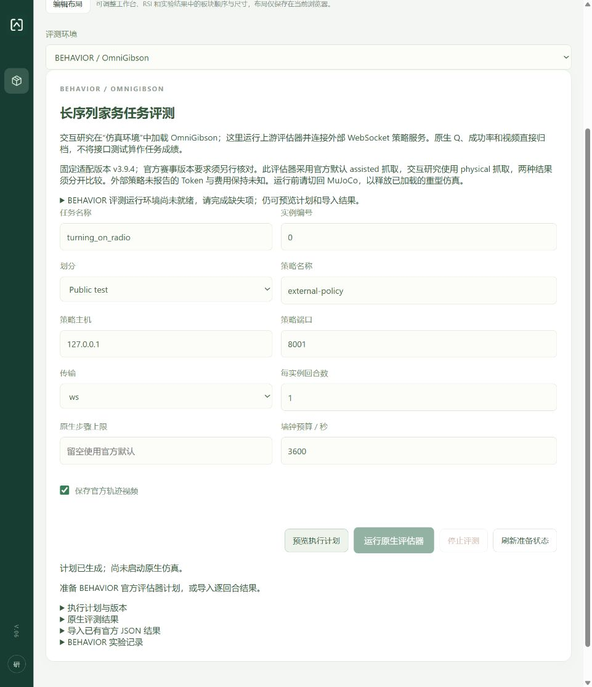

# BEHAVIOR / OmniGibson 平台集成验收记录

日期：2026-11-02。范围：平台侧原生适配、模型控制链路、观察归档、独立评价和官方评估器桥接；没有安装 SDK、下载许可资产或调用付费模型。

固定版本为 BEHAVIOR-1K `v3.9.4` / `fe66cc74538f7eba3c57255da0ee88e8ce113c87`，独立 Python 3.11 / Isaac Sim 5.1。部署步骤、版本依据和许可边界见 [OmniGibson 指南](../omnigibson.md)。

## 已完成的接线

- 仿真环境目录、资源和依赖预检、独立进程、官方预采样任务与实例选择。
- R1Pro 全身原生动作；普通 Agent、自定义 VLA/WAM 和单次组合决策支持后端动作合同。
- 动态 RGB 相机、米制深度 NPY、本体状态、动作轨迹与可选视频归档。
- BDDL 完整成功和 Q 分数分别记录；环境终止或截断后停止推理，保留失败与超时原因。
- 官方评估器真实 CLI、外部 WebSocket 策略、串行实例、取消、结果导入和现有实验管理。
- 交互 `physical` 与官方默认 `assisted` 抓取分开标记；外部未报告的费用保持未知。

## 验证结果

| 检查 | 实际结果 |
| --- | --- |
| 后端集成及受影响控制链路，共 183 项 | 181 项通过，2 项原生 SDK 验收跳过；任务目录收窄后同步修正准备检查的旧路径 fixture，并复验其 10 项测试全部通过 |
| 前端状态和交互合同 | 102 项通过 |
| 生产前端构建 | `npm run build` 通过 |
| 浏览器实际页面 | 环境入口可见；未就绪保持当前 MuJoCo；BEHAVIOR 计划可生成、运行禁用；无浏览器错误 |
| 真实轻量子进程 | 官方 CLI 边界、输出归档、错误/超时/取消测试通过；Windows 后代清理不影响无关进程 |
| 本机准备检查 | 未就绪：15.8 GiB 内存、未配置原生 SDK/资产；检查不导入 SDK、不下载资产 |
| 原生 GPU 物理 | OmniGibson 与已有 RoboDojo 原生测试均未运行；不能推导任何真实任务成功率 |

联合检查覆盖 OmniGibson runtime/backend、native agent/episode stop、观察/终止/训练归档、BEHAVIOR API/评测桥，以及既有 Agent 轮次、离散环境、完成判定、组合控制、进程隔离和 RoboDojo 适配。

待原生主机验收：真实首帧、动作引起的物理变化、任务成功正例与失败负例、不同任务的反复加载、整轮视频与训练导出、资源释放。完整状态恢复、同初态配对实验及 HarnessPAI 的 R1Pro 原语迁移未声明支持。

## 页面证据

下图是平台集成界面，**不是原生仿真任务已经运行的证据**。

