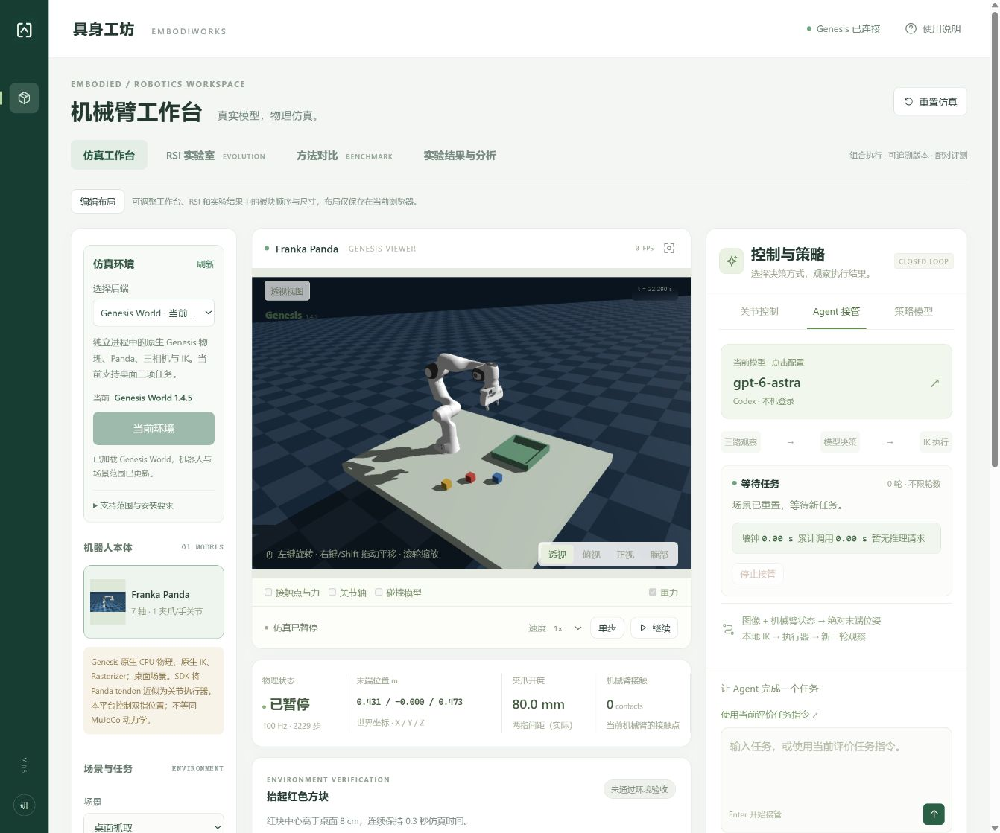

# 仿真环境与任务套件

EmbodiWorks 在同一个工作台选择仿真后端，复用策略接入、实验记录、视频与物理任务评价。每次切换只加载一个后端；正在执行任务时须先停止，切换会重置当前仿真。

在左侧 **仿真环境** 中选择后端，再点击 **加载环境**。后端目录由服务检测，分为“可加载”“未安装”“尚未适配”。安装依赖后点击 **刷新** 检查目录。加载失败保留当前可用后端；服务会显示真实错误，不会静默换回其他引擎继续实验。



## 当前范围

| 后端 | 本项目的实现范围 | 依赖与验证边界 |
| --- | --- | --- |
| MuJoCo | 现有机械臂、多臂场景、三路观察、关节/末端控制、Agent/VLA/WAM、任务评价及实验记录 | 使用主 `.venv`；已有 Windows 本机与三平台 CI 验证范围见 [安装文档](INSTALL.md)。 |
| Genesis World | Panda 桌面环境；抬起、放置红方块及末端到达任务；沿用同一工作台操作入口 | 独立 `.venv-genesis`；本台 Windows CPU 已通过 7 项原生测试与 1 项工作台集成测试，Linux / macOS 尚待实机验收。 |
| ManiSkill / SAPIEN | 目录展示与官方安装入口 | 尚未适配任务或执行器，不可加载。 |
| Isaac Sim / Isaac Lab | 目录展示与官方安装入口 | 尚未适配；重型 RTX 仿真推荐独立工作站。 |
| OmniGibson / BEHAVIOR | 目录展示与官方安装入口 | 尚未适配；包含独立资产、任务与许可条件。 |

现有 MuJoCo 场景和机器人不会自动转换为其他引擎资源。切换后以当前后端返回的机器人、任务及能力为准。跨引擎对比还需要校准初态、物理参数和评价协议，不能仅凭相同种子认定场景完全相同。

## Genesis 独立运行环境

主工作台继续使用 Python 3.13 的 `.venv`，Genesis 放入 `.venv-genesis`，避免其 PyTorch、编译器与渲染依赖影响现有服务。当前固定的版本见项目根目录 `requirements-genesis.txt`；不要将其安装到主 `.venv`。

以下命令只安装依赖，不启动另一套工作台服务。

Windows PowerShell，在仓库根目录执行：

```powershell
py -3.13 -m venv .venv-genesis
.venv-genesis\Scripts\python.exe -m pip install --upgrade pip
.venv-genesis\Scripts\python.exe -m pip install torch==2.10.0 --index-url https://download.pytorch.org/whl/cpu
.venv-genesis\Scripts\python.exe -m pip install --no-compile -r requirements-genesis.txt
```

Linux CPU：

```sh
python3.13 -m venv .venv-genesis
.venv-genesis/bin/python -m pip install --upgrade pip
.venv-genesis/bin/python -m pip install torch==2.10.0 --index-url https://download.pytorch.org/whl/cpu
.venv-genesis/bin/python -m pip install --no-compile -r requirements-genesis.txt
```

macOS Apple Silicon：

```sh
python3.13 -m venv .venv-genesis
.venv-genesis/bin/python -m pip install --upgrade pip
.venv-genesis/bin/python -m pip install torch==2.10.0
.venv-genesis/bin/python -m pip install --no-compile -r requirements-genesis.txt
```

安装完成后，正常 `npm start` 启动主服务，在环境卡中刷新目录并加载 Genesis。第一次初始化会编译物理内核，耗时与 CPU、驱动和缓存有关；按钮加载结束前请等待服务结果。

本机测得首次 `Scene.build` 编译约 **241 秒**，缓存后的初始化约 **33 秒**。这是本台 Windows 机器的测量结果，不是其他机器或场景的加载时间保证。

本项目初始适配使用单场景 **CPU 物理与离屏相机**，不要求安装 CUDA 版 PyTorch。CPU 物理与相机渲染是两套硬件路径：相机仍需要可用的 OpenGL 后端。安装成功不等于离屏渲染可用，必须实际加载并检查三路图像和关节运动。

Genesis 上游使用 MuJoCo 解析 MJCF 模型资源，因此其独立环境仍会安装该依赖。本适配器的物理步进、IK、PD 控制和相机渲染由 Genesis 执行；模型资源格式与实际动力学引擎分别记录。

Genesis 上游支持 Python 3.10–3.13，Windows、Linux 与 Apple Silicon macOS，并提供 CPU/CUDA/ROCm/Metal 等物理后端。上游功能覆盖不等于本项目已经验收所有平台或开启全部求解器。[官方安装与平台支持](https://genesis-world.readthedocs.io/en/latest/user_guide/overview/installation.html)、[PyPI 版本](https://pypi.org/project/genesis-world/)。

- **Windows**：本项目使用原生 Windows 进程，离屏 OpenGL 需显卡驱动支持。不要直接复制 WSL 的虚拟环境。
- **Linux**：离屏相机通常走 EGL；无显示器环境需要可用的 EGL 或其他适配的 OpenGL 实现。物理能运行、相机初始化失败时，请检查实际渲染驱动。
- **macOS**：上游支持 Apple Silicon，离屏使用平台对应的 OpenGL 路径；本项目 Genesis 完整流程仍需 Mac 真机验收。普通 PyPI PyTorch 与 Linux CPU 索引的安装命令不同。
- **WSL**：CUDA 可见性与 OpenGL/WSLg 渲染分别检查，不以 `nvidia-smi` 可用来判断相机已可用；本项目不将其视为所有后端共同支持的 GPU 运行平台。

## 验证本机适配

2026-10-24，本台 Windows 的 Genesis 1.4.5 + CPU PyTorch 2.10.0 独立环境通过 **7 项原生测试与 1 项工作台集成测试**，覆盖真实三路图像、IK、独立环境验收、轨迹、视频解码及状态回放。集成测试使用本地固定推理响应，未调用外部模型。Genesis 的 Linux、WSL 与 macOS 完整流程仍待实机验收。

主环境本轮回归共 **304 项，296 项通过、8 项可选测试跳过**；独立 Genesis 测试按下方命令另行运行，跳过项不作为已通过计数。另有 27 项前端与 5 项跨平台启动器检查通过，前端生产构建通过。

主环境 `npm test` 会明确跳过未安装在该解释器中的原生 Genesis 测试；跳过不代表通过。安装独立环境后，在项目根目录分别运行：

```powershell
.venv-genesis\Scripts\python.exe -m unittest tests.test_genesis_backend -v
$env:EMBODI_TEST_GENESIS = '1'
.venv\Scripts\python.exe -m unittest tests.test_genesis_integration -v
Remove-Item Env:EMBODI_TEST_GENESIS
```

Linux/macOS 使用对应的 `.venv-genesis/bin/python` 运行原生测试，再用 `EMBODI_TEST_GENESIS=1 .venv/bin/python -m unittest tests.test_genesis_integration -v` 运行隔离进程与工作台集成测试。集成测试只替换模型推理，真实运行物理、IK、三相机、任务验收、轨迹和回放；检测到 FFmpeg 时还会保存并解码视频。测试使用临时记录目录，不调用外部模型或改写用户实验。

## 生态选择与边界

“引擎”和“任务套件”分开记录：SAPIEN 提供物理与渲染，ManiSkill 在其上提供任务、控制器、数据与成功判据；Isaac Lab 提供机器人训练和实验框架；BEHAVIOR 为 OmniGibson 提供家庭任务与资产。选择同一个任务套件，也可能涉及不同的物理和渲染路径。

| 仿真栈 | 适用方向 | 官方条件与本项目取舍 |
| --- | --- | --- |
| [ManiSkill 3 / SAPIEN](https://maniskill.readthedocs.io/en/latest/user_guide/getting_started/installation.html) | 桌面操作、灵巧操作、移动操作与标准任务评价 | GPU 物理与渲染完整支持以 Linux + NVIDIA 为主；Windows 支持 CPU 物理与 Vulkan 渲染。官方表中 WSL 不支持渲染。源码与资产许可分别核实。 |
| [Isaac Sim](https://docs.isaacsim.omniverse.nvidia.com/latest/installation/requirements.html) | 高保真相机、多机器人、数字孪生、ROS 2 | 当前完整 RTX 运行栈官方列 Windows 11 / Ubuntu，至少 32 GB RAM、16 GB VRAM；16 GB RAM / 8 GB VRAM 的本机不作为其默认部署目标。 |
| [Isaac Lab 3](https://github.com/isaac-sim/IsaacLab/releases/tag/v3.0.0) | 强化学习、模仿学习、多后端训练与策略评测 | Python 3.12；完整 Isaac Sim 工作流对应 6.2。3.0 也支持无需 Isaac Sim 的 Newton 物理、Warp 相机与 Viser/Rerun 可视化，后续可单独适配。 |
| [OmniGibson / BEHAVIOR](https://behavior.stanford.edu/getting_started/installation) | 家庭长程任务、整理、清洁、烹饪及符号谓词评价 | 基于 Isaac Sim，官方安装要求 32 GB RAM、8 GB+ VRAM；软件、运行时、场景和物体资产有各自许可。 |
| [Habitat-Sim / Habitat-Lab](https://github.com/facebookresearch/habitat-sim) | 导航、场景重排与人机协作 | Sim/Lab 官方 README 公告 Meta 团队在 v0.3.4 后不再主动维护，作为已有研究的兼容候选。 |
| [PyBullet](https://pypi.org/project/pybullet/) | 成熟刚体基线、IK 与 CPU 相机 | 官方 3.2.7 的预编译 wheel 与主 Python 3.13 不匹配，需要独立运行环境或自行构建；尚未接入。 |

以上上游资料核验日期为 **2026-10-24**；版本和硬件要求会变化。当前固定 Genesis 1.4.5 与 CPU PyTorch 2.10.0，其他依赖按清单约束安装，尚未提供覆盖所有平台的完整依赖锁文件。引擎升级须重新验收，不在实验中自动升级。

## 后续接入与维护

本次建立按后端检测和选择的入口，保留每套仿真的独立环境。远程 Isaac、ManiSkill 或其他工作站的连接协议属于后续接入方向，**当前没有随项目部署远程仿真服务**，也不能仅填一个地址就获得尚未适配的后端。

新增后端需要同时完成场景加载、动作和坐标约定转换、同步传感器、关节状态、物理评价与资源释放，并通过实际依赖下的回归。只在目录中登记名称不会变成“可加载”。

实验记录保存后端名称、版本、任务与评价来源。控制模型使用图像与机器人状态；特权坐标和关节开度等证据由环境评价器管理。模型的完成声明继续申请环境验收，不能替代最终成功判据。

方法版本会追溯 `server/` 下的后端代码和依赖清单；评测协议冻结指定引擎及评价实现。升级代码或引擎后，需要登记新的方法和评测协议再运行严格对照；历史日志、视频和协议文件保持原样。分析页按物理环境和评价契约分组，不会混合不同后端的结果。同一随机种子只保证各自后端的布局生成可重复，不能据此宣称跨引擎初态或动力学完全一致。

源码许可不代表所有资产可以重新分发。Genesis 源码为 Apache-2.0；ManiSkill / SAPIEN 源码主要为 Apache-2.0，ManiSkill 资产有 CC BY-NC 4.0 等条款；Isaac Lab 为 BSD-3-Clause、部分组件 Apache-2.0，Isaac 运行时还含其他条款；BEHAVIOR 代码为 MIT，场景资产另有约束。安装或分发新资产前核实其具体来源与许可。[Genesis 许可](https://github.com/Genesis-Embodied-AI/genesis-world/blob/main/LICENSE)、[ManiSkill 说明](https://github.com/mani-skill/ManiSkill)、[Isaac Lab 许可说明](https://github.com/isaac-sim/IsaacLab/tree/v3.0.0#license)、[BEHAVIOR 体系](https://behavior.stanford.edu/getting_started/important_concepts.html)。
